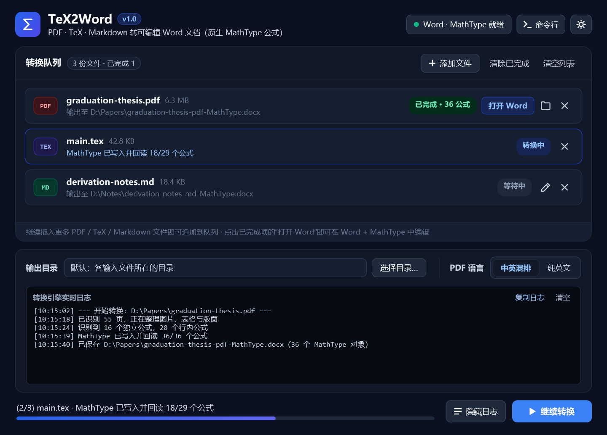

<p align="center">
  <strong>English</strong> &nbsp;|&nbsp; <a href="README.zh-CN.md">简体中文</a>
</p>

<h1 align="center">TeX2Word</h1>

<p align="center">
  <strong>Windows desktop app & CLI tool for converting PDF, TeX (<code>.tex</code>), and Markdown (<code>.md</code>) documents into editable Microsoft Word (<code>.docx</code>) files with native editable MathType equations.</strong>
</p>

<p align="center">
  
  
  
  
  
</p>

---

> **Windows Only:** TeX2Word runs **exclusively on 64-bit Windows 10 / 11** and requires **Microsoft Word (desktop)** and **MathType 7 (desktop)**. Every inline and display equation is written as a genuine embedded MathType OLE object (`Equation.DSMT4` / `Equation Native` MTEF stream) via Windows COM and the MathType desktop SDK—**not** static images and **not** Word OMML. Double-clicking any equation in Word opens it directly in MathType for full editing.

## Preview

<table>
  <tr>
    <td align="center"><strong>Light Mode</strong></td>
    <td align="center"><strong>Dark Mode + Live Log Drawer</strong></td>
  </tr>
  <tr>
    <td></td>
    <td></td>
  </tr>
</table>

## Features

- **Three Input Formats → Editable Word + MathType**
  - **PDF (`.pdf`)**: Offline local layout analysis, OCR, and formula recognition powered by RapidDoc (`PP-DocLayoutV3` + `PP-FormulaNet_plus-M` + `PP-OCRv6`). Reconstructs native vector + raster figures cleanly, formats academic three-line tables, checks inline symbols against the PDF text layer, handles both text-layer and scanned PDFs, and supports Chinese/English mixed (`ch`) and English (`en`) modes.
  - **LaTeX / TeX (`.tex`)**: Supports UTF-8, GB18030, and `% !TeX encoding=...` headers; automatically expands relative `\input` / `\include` files; preserves macros, chapter/section structure, numbered equation environments (`equation`, `align`, `alignat`, `gather`, `multline`, `eqnarray`), `.aux`-backed bookmarks and live Word `REF` cross-references, plus stretchable MTEF horizontal braces (`\underbrace` / `\overbrace`).
  - **Markdown (`.md`, `.markdown`)**: Converts standard `$...$` / `$$...$$`, LLM/Typora-style `\(...\)` / `\[...\]`, standalone AMS math environments, `\tag` / `\label` / `\eqref`, relative images, Markdown pipe tables, and raw HTML `<table>` blocks (including math inside table cells).
- **Strict MathType Verification & Atomic Output**
  - Every generated equation is read back through MathType during conversion and verified at the OOXML / OLE `Equation Native` MTEF binary stream level before publishing.
  - All temporary staging files stay inside the system `%TEMP%` directory; the final `.docx` is published atomically only after verification passes.
- **Modern Windows Desktop GUI + Full CLI**
  - Fluent-inspired WPF desktop app with Light/Dark theme switching, drag-and-drop mixed-format batch queue, per-file progress and equation counts, one-click open in Word / reveal in Explorer, live engine log drawer, and instant environment diagnostics.
  - Full command-line tool (`tex2word`) automatically added to user `PATH` by the installer for batch scripts and automation.
- **Fully Offline Conversion**
  - The Windows installer bundles Python 3.12, Pandoc, all Python libraries, and local OCR/formula ONNX models—no internet connection or cloud API keys required.

## System Requirements

| Component | Requirement |
| --- | --- |
| **Operating System** | **Windows 10 / Windows 11 (64-bit / x64 only)** — macOS and Linux are not supported |
| **Word Processor** | Microsoft Word desktop edition (Office 2016 / 2019 / 2021 / Microsoft 365) |
| **Equation Editor** | MathType 7 desktop edition (registered `Equation.DSMT4` COM class + `MT6.dll`) |
| **Source Development** | Python 3.12 (x64); building the installer also requires `uv` and Visual Studio Build Tools (x64 C++ Redistributable) |

## Installation

### Option 1: Windows Offline Installer (Recommended)

1. Download `TeX2Word-Setup-1.0.0-x64.exe` from [GitHub Releases](../../releases) (or [build it from source](#building-the-windows-installer)).
2. Double-click the installer to install per-user under `%LOCALAPPDATA%\Programs\TeX2Word` (no administrator privileges required).
3. Launch **TeX2Word** from the Desktop / Start Menu shortcut, or run `tex2word` directly in PowerShell / Command Prompt.
4. Uninstall cleanly anytime from Windows **Settings → Apps → Installed apps**.

### Option 2: Run from Source

```powershell
git clone https://github.com/<your-username>/TeX2Word.git
cd TeX2Word
.\Setup.cmd
```

Or install in editable mode into a virtual environment:

```powershell
python -m venv .venv
.\.venv\Scripts\pip.exe install -e .
```

## Usage

### 1. Desktop App (GUI)

1. Open **TeX2Word** (installed app) or run `.\Start.cmd` (from source).
2. Drag and drop one or more `.pdf`, `.tex`, or `.md` files into the window (or click **选择文档…** / press `Ctrl+O`). Mixed formats in one queue are fully supported. For multi-file TeX projects, select the main `.tex` file.
3. Optionally choose a unified output directory (defaults to each source file's folder) and select the PDF recognition language (**中英混排** for Chinese/bilingual, **纯英文** for English-only).
4. Click **开始转换** (or press `F5`). Completed files show the verified MathType equation count and can be opened directly in Word or located in File Explorer.

### 2. Command Line (CLI)

The Windows installer registers `TeX2Word.com` in the current user's `PATH`, so you can run `tex2word` directly from any PowerShell or Command Prompt window (or explicitly invoke `TeX2Word.exe --cli ...`; from source, use `.\Start.cmd ...` or `python -m tex2word ...`):

```powershell
# Convert a PDF document (Chinese / bilingual default)
tex2word "D:\Papers\thesis.pdf" -o "D:\Papers\thesis-MathType.docx"

# Convert an English-only PDF and overwrite existing output
tex2word "D:\Papers\paper.pdf" --lang en -o "D:\Papers\paper-editable.docx" --force

# Convert a TeX project (main .tex file)
tex2word "D:\Papers\main.tex" -o "D:\Papers\main-MathType.docx"

# Convert a Markdown document with LaTeX math
tex2word "D:\Notes\derivation.md" -o "D:\Notes\derivation-MathType.docx"

# Batch-convert mixed PDF, TeX, and Markdown files into a single output folder
tex2word "D:\Papers\a.pdf" "D:\Papers\b.tex" "D:\Notes\c.md" -d "D:\Output"

# Verify that all equations in an existing .docx are intact native MathType objects
tex2word --verify "D:\Papers\thesis-MathType.docx"

# Launch the GUI pre-loaded with files
tex2word --gui "D:\Papers\thesis.pdf" "D:\Notes\derivation.md"
```

#### CLI Options

| Option | Description |
| --- | --- |
| `sources` | One or more input `.pdf`, `.tex`, `.md`, or `.markdown` files |
| `-o, --output PATH` | Output `.docx` path (single-file mode) |
| `-d, --output-dir DIR` | Output directory for batch conversion |
| `--lang {ch,en}` | PDF OCR language: `ch` (Chinese / bilingual, default) or `en` (English) |
| `--date TEXT` | Override TeX title-page `\today` date string |
| `--force` | Overwrite an existing output `.docx` file |
| `--verify DOCX` | Inspect and verify all embedded `Equation.DSMT4` OLE streams in a `.docx` |
| `--gui` | Open the desktop GUI (optionally pre-loading the given files) |
| `-V, --version` | Print TeX2Word version |

### 3. Python API

```python
from tex2word.convert import convert
from tex2word.word import verify

output_path, equation_count = convert(
    r"D:\Notes\derivation.md",
    r"D:\Notes\derivation-MathType.docx",
    lang="ch",
    overwrite=True,
)
print(f"Saved {output_path} with {equation_count} verified MathType equations.")
assert verify(output_path) == equation_count
```

### Custom MathType Path

If MathType 7 is installed in a non-standard directory, point `MATHTYPE_DLL` to the 64-bit `MT6.dll` matching your Python architecture:

```powershell
$env:MATHTYPE_DLL = "D:\Tools\MathType\System\64\MT6.dll"
```

## Input & Output Notes

- **Default Output Names**: `<name>-pdf-MathType.docx`, `<name>-tex-MathType.docx`, or `<name>-md-MathType.docx` next to the input file. The desktop GUI automatically appends ` (2)`, ` (3)`, etc. to avoid accidentally overwriting existing files unless you explicitly choose a target with **Save As**.
- **TeX Projects**: Keep relative sub-files, figures, and existing `.aux` files in place when selecting the main `.tex` file.
- **PDF Recognition**: Local OCR handles both digital and scanned PDFs, including figures, academic tables, and inline/display formulas. Because PDF layout recovery is heuristic, always proofread tiny sub/superscripts, look-alike symbols, and complex multi-column pages; Word will also reflow pagination to match editable content.
- **Markdown**: Supports `$...$`, `$$...$$`, `\(...\)`, `\[...\]`, standalone `\begin{equation}` / `\begin{align}` blocks, Markdown pipe tables, and raw HTML `<table>` blocks without touching fenced/inline code or bare citations like `\[1\]`.

## Building the Windows Installer

Requires 64-bit Windows, Python 3.12, [`uv`](https://docs.astral.sh/uv/), and Visual Studio Build Tools with the x64 C++ Redistributable:

```powershell
python packaging\windows\build.py
```

To reuse already-downloaded RapidDoc/RapidOCR ONNX models from `.venv` (SHA-256 verified):

```powershell
python packaging\windows\build.py --model-cache .venv\Lib\site-packages
```

The self-contained installer is written to `release\TeX2Word-Setup-1.0.0-x64.exe`.

## Testing

### Offline Unit Tests (no Word / MathType required)

```powershell
.\.venv\Scripts\python.exe -m unittest discover -s tests -v
```

### Full Integration & Installed App Tests (requires Word + MathType 7)

```powershell
$env:TEX2WORD_OFFICE_TEST = '1'
$env:TEX2WORD_INSTALL = Join-Path $env:LOCALAPPDATA 'Programs\TeX2Word'
.\.venv\Scripts\python.exe -m unittest discover -s tests -v
```

## Project Structure

```text
TeX2Word/
├── tex2word/                  # Core Python conversion engine
│   ├── convert.py             # Orchestration, %TEMP% staging & atomic publish
│   ├── pdf_input.py           # Local RapidDoc PDF layout/OCR, figure & table cleanup
│   ├── tex_input.py           # TeX encoding detection & \input/\include expansion
│   ├── md_input.py            # Markdown math & HTML table normalization
│   ├── manuscript.py          # Pandoc AST rewriting, numbering, TOC & cross-refs
│   ├── mathml.py              # Pandoc TeX -> MathML preparation
│   ├── braces.py              # Stretchable MTEF horizontal brace templates
│   ├── word.py                # Word COM + MathType SDK embedding & OLE verification
│   ├── winpath.py             # User PATH registration helper for Windows installer
│   ├── gui.py                 # Lightweight Tkinter fallback UI for source runs
│   └── __main__.py            # CLI entry point (tex2word)
├── desktop/                   # Windows Fluent WPF desktop app & CLI wrapper (C#)
│   ├── MainWindow.xaml        # Modern Light/Dark Fluent UI layout & templates
│   ├── Program.cs             # WPF application controller & batch queue logic
│   ├── Conversion.cs          # Observable conversion job model & progress parser
│   ├── Theme.cs               # Dynamic Light/Dark palette manager
│   ├── ShellDialogs.cs        # Modern IFileOpenDialog folder picker & DWM titlebar
│   ├── Cli.cs / CliRunner.cs  # Console CLI wrapper (TeX2Word.com) & engine launcher
│   └── app.manifest           # PerMonitorV2 HiDPI manifest
├── packaging/windows/         # Self-contained NSIS Windows x64 installer builder
├── tests/                     # Unit, Markdown/TeX/PDF fixtures & installed-app tests
├── docs/screenshots/          # GUI preview screenshots
├── pyproject.toml             # Python packaging metadata
├── Setup.cmd / Start.cmd      # Quick Windows source setup & launcher scripts
└── LICENSE                    # MIT License
```

## How It Works

1. **Document Parsing**:
   - `.tex` files are decoded, expanded (`\input`/`\include`), and parsed by Pandoc.
   - `.md` files are normalized for common LaTeX math delimiters and HTML tables, then parsed by Pandoc.
   - `.pdf` files are analyzed locally via RapidDoc (`PP-DocLayoutV3`, `PP-FormulaNet_plus-M`, `PP-OCRv6`), reconciled with `pypdfium2` native image/vector bounds and `pdftext` glyph evidence, then parsed by Pandoc.
2. **MathML & Structural Rewriting**: Pandoc converts each TeX formula into Presentation MathML while preserving equation numbers, Word bookmarks, `REF` cross-reference fields, and academic three-line table styles.
3. **Native MathType Embedding**: Each formula anchor in the staged `.docx` is replaced via Word COM and the MathType 7 desktop SDK (`MT6.dll`) with an embedded `Equation.DSMT4` OLE object (using custom MTEF horizontal brace templates where needed), read back to catch missing glyphs, and structurally verified before atomic output.

## Acknowledgements & License

- [Pandoc](https://pandoc.org/) — universal document parser & MathML generator
- [RapidDoc](https://github.com/RapidAI/RapidDoc) / [RapidOCR](https://github.com/RapidAI/RapidOCR) / [PaddleOCR](https://github.com/PaddlePaddle/PaddleOCR) — offline PDF layout, OCR & formula recognition
- [dsh-mathtype](https://github.com/DIPPER12138/dsh-mathtype) — reference for MathType OLE embedding
- [MTEF 5 Specification](https://rtf2latex2e.sourceforge.net/MTEF5.html) — MathType Equation Native binary format

Third-party component notices bundled with the Windows installer are listed in [packaging/windows/third-party.txt](packaging/windows/third-party.txt).

This project is licensed under the [MIT License](LICENSE).
