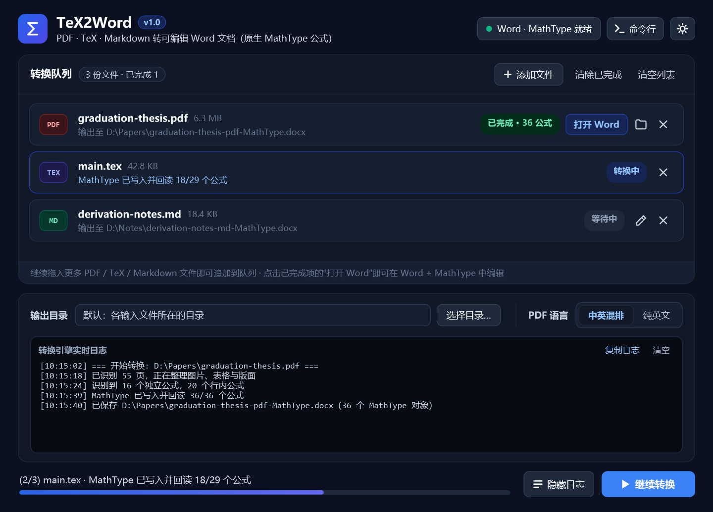

<p align="center">
  <a href="README.md">English</a> &nbsp;|&nbsp; <strong>简体中文</strong>
</p>

<h1 align="center">TeX2Word</h1>

<p align="center">
  <strong>适用于 Windows 的桌面端与命令行工具：将 PDF、TeX（<code>.tex</code>）和 Markdown（<code>.md</code>）文档转换为可编辑的 Word（<code>.docx</code>），并将所有行内与独立公式写入为原生可编辑的 MathType 公式对象。</strong>
</p>

<p align="center">
  
  
  
  
  
</p>

---

> **仅适用于 Windows 平台：** 本工具仅支持 **64 位 Windows 10 / 11**，运行转换需要本机已安装 **Microsoft Word 桌面版** 与 **MathType 7 桌面版**。所有公式均通过 Windows COM 与 MathType 桌面 SDK 写入为原生内嵌 OLE 对象（`Equation.DSMT4` / `Equation Native` MTEF 数据流），**不是**静态图片，也**不是** Word 自带 OMML 公式；在 Word 中双击任意行内或独立公式，即可直接唤起 MathType 编辑。

## 界面预览

<table>
  <tr>
    <td align="center"><strong>浅色主题</strong></td>
    <td align="center"><strong>深色主题 + 实时日志面板</strong></td>
  </tr>
  <tr>
    <td></td>
    <td></td>
  </tr>
</table>

## 核心特性

- **三大输入格式 → 可编辑 Word + 原生 MathType 公式**
  - **PDF（`.pdf`）**：内置 RapidDoc（`PP-DocLayoutV3` + `PP-FormulaNet_plus-M` + `PP-OCRv6`）本地离线识别版面、正文、表格与公式；结合 `pypdfium2` 原生图像/矢量边界重组完整插图（避免插图碎裂与缩放异常）；结合 PDF 文字层核对行内符号与上下标；自动格式化规范学术三线表；同时支持电子版 PDF 与扫描件，提供“中英混排 / 纯英文”两种识别模式。
  - **LaTeX / TeX（`.tex`）**：自动识别 UTF-8、GB18030 及 `% !TeX encoding=...` 编码声明；递归展开相对路径的 `\input` / `\include` 子文件；保留常见宏、章节编号、`equation` / `align` / `alignat` / `gather` / `multline` / `eqnarray` 数学环境；自动读取 `.aux` 中的公式编号并生成 Word 书签与动态 `REF` 交叉引用；对 `\underbrace` / `\overbrace` 使用 MathType 原生 MTEF 可伸展水平大括号模板。
  - **Markdown（`.md`、`.markdown`）**：原生支持 `$...$` / `$$...$$`、常见 AI / Typora 导出的 `\(...\)` / `\[...\]`、带空格的行内公式 `$ x + y $`、独立 AMS 数学环境、`\tag` / `\label` / `\eqref` 公式编号与引用、相对路径插图，以及标准 Markdown 表格与内嵌 HTML `<table>`（含单元格内 MathType 公式），同时自动跳过代码块与普通引用 `\[1\]`。
- **严格的 MathType 回读校验与原子发布**
  - 每个公式写入 Word 后都会通过 MathType 实时回读检查；发布前逐一校验 OOXML 中的 `Equation.DSMT4` 对象、OLE 关系及 `Equation Native` 二进制 MTEF 流。
  - 所有中间临时文件均隔离在系统 `%TEMP%` 目录，仅在全部公式写入并校验通过后才原子发布到目标目录，彻底避免产生残缺或未转换占位符文件。
- **现代 Fluent 桌面端 + 完整命令行（CLI）**
  - 全新 WPF 桌面界面：支持浅色/深色主题一键切换、拖放多格式混合批量队列、单文件实时进度与已写入公式数显示、一键打开 Word / 资源管理器定位、可折叠实时日志面板与 Word/MathType 环境自检。
  - 安装版自动将 `tex2word` 加入当前用户 `PATH`，可在 PowerShell / CMD 中直接命令行调用，便于批量处理和脚本集成。
- **纯本地离线运行**
  - Windows 安装包已内置 Python 3.12、Pandoc、依赖库与 OCR/公式识别模型，安装和转换全程无需联网、无需任何云端 API Key。

## 系统要求

| 项目 | 要求 |
| --- | --- |
| **操作系统** | **Windows 10 / Windows 11（仅支持 64 位 x64）** — 不支持 macOS / Linux |
| **办公软件** | Microsoft Word 桌面版（Office 2016 / 2019 / 2021 / Microsoft 365） |
| **公式编辑器** | MathType 7 桌面版（需已注册 `Equation.DSMT4` COM 组件与 `MT6.dll`） |
| **源码开发 / 打包** | Python 3.12（64 位）；从源码构建离线安装包另需 `uv` 和含 x64 C++ 可再分发组件的 Visual Studio Build Tools |

## 安装方式

### 方式一：Windows 离线安装包（推荐）

1. 从 [GitHub Releases](../../releases) 下载 `TeX2Word-Setup-1.0.0-x64.exe`（或按下方说明[从源码构建安装包](#从源码构建-windows-离线安装包)）。
2. 双击运行安装程序，默认安装在当前用户目录 `%LOCALAPPDATA%\Programs\TeX2Word`（无需管理员权限）。
3. 从桌面或开始菜单打开 **TeX2Word**，或在任意 PowerShell / 命令提示符中直接使用 `tex2word` 命令。
4. 如需卸载，可在 Windows“设置 → 应用 → 已安装的应用”中一键卸载。

### 方式二：从源码运行

```powershell
git clone https://github.com/Swk6666/TeX2Word.git
cd TeX2Word
.\Setup.cmd
```

也可在虚拟环境中以可编辑模式安装：

```powershell
python -m venv .venv
.\.venv\Scripts\pip.exe install -e .
```

## 使用指南

### 1. 图形界面（GUI）

1. 打开已安装的 **TeX2Word**（源码环境可运行 `.\Start.cmd`）。
2. 将一份或多份 `.pdf`、`.tex`、`.md` 文件直接拖入窗口，或点击 **选择文档…**（快捷键 `Ctrl+O`）。支持不同格式混合排队转换；多文件 TeX 项目请选择主 `.tex` 文件。
3. 可按需选择统一输出目录（默认保存到各输入文件所在目录），并为 PDF 选择识别语言（**中英混排** 或 **纯英文**）。
4. 点击 **开始转换**（快捷键 `F5`）。完成后每项都会显示验证通过的 MathType 公式数量，点击 **打开 Word** 即可直接编辑文档和公式。

### 2. 命令行（CLI）

安装版会自动将 `TeX2Word.com` 所在目录写入当前用户的 `PATH`，安装后可在任意 PowerShell / CMD 中直接运行 `tex2word`（也可显式调用 `TeX2Word.exe --cli ...`；源码目录可用 `.\Start.cmd ...` 或 `python -m tex2word ...`）：

```powershell
# 转换 PDF（默认中英混排）
tex2word "D:\论文\毕业论文.pdf" -o "D:\论文\毕业论文-MathType.docx"

# 转换纯英文 PDF 并覆盖已有输出
tex2word "D:\论文\paper.pdf" --lang en -o "D:\论文\paper-editable.docx" --force

# 转换 TeX 主文件
tex2word "D:\论文\main.tex" -o "D:\论文\论文-公式版.docx"

# 转换 Markdown 文档（支持行内/独立 LaTeX 公式与表格）
tex2word "D:\笔记\推导笔记.md" -o "D:\笔记\推导笔记-MathType.docx"

# 混合批量转换 PDF、TeX、Markdown 到指定目录
tex2word "D:\论文\a.pdf" "D:\论文\b.tex" "D:\笔记\c.md" -d "D:\输出"

# 校验已有 Word 文档中的原生 MathType 公式对象
tex2word --verify "D:\论文\毕业论文-MathType.docx"

# 启动图形界面并预先载入指定文件
tex2word --gui "D:\论文\毕业论文.pdf" "D:\笔记\推导笔记.md"
```

#### 命令行参数说明

| 参数 | 说明 |
| --- | --- |
| `sources` | 一个或多个 `.pdf`、`.tex`、`.md`、`.markdown` 输入文件 |
| `-o, --output PATH` | 指定输出 `.docx` 文件路径（单文件转换时使用） |
| `-d, --output-dir DIR` | 批量转换时统一输出到此目录 |
| `--lang {ch,en}` | PDF 识别语言：`ch`（中文或中英混排，默认）或 `en`（纯英文） |
| `--date TEXT` | 指定 TeX 标题页 `\today` 的固定日期文本 |
| `--force` | 允许覆盖已存在的输出 `.docx` 文件 |
| `--verify DOCX` | 校验指定 `.docx` 中所有内嵌 `Equation.DSMT4` 原生数据流 |
| `--gui` | 启动桌面图形界面（可同时传入待加载文件） |
| `-V, --version` | 显示当前版本号 |

### 3. Python API 调用

```python
from tex2word.convert import convert
from tex2word.word import verify

output_path, equation_count = convert(
    r"D:\笔记\推导笔记.md",
    r"D:\笔记\推导笔记-MathType.docx",
    lang="ch",
    overwrite=True,
)
print(f"已生成 {output_path}，共 {equation_count} 个已校验的 MathType 公式")
assert verify(output_path) == equation_count
```

### 自定义 MathType 路径

如果 MathType 7 安装在非默认目录，可通过环境变量 `MATHTYPE_DLL` 指定与 Python 位数一致的 64 位 `MT6.dll`：

```powershell
$env:MATHTYPE_DLL = "D:\Tools\MathType\System\64\MT6.dll"
```

## 输入输出与注意事项

- **默认命名**：在源文件同目录生成 `文件名-pdf-MathType.docx`、`文件名-tex-MathType.docx` 或 `文件名-md-MathType.docx`。图形界面遇到同名文件会自动追加 ` (2)`、` (3)` 序号，避免意外覆盖原稿。
- **TeX 源码**：请保留主 `.tex` 相对引用的子文件、图片目录以及已生成的 `.aux` 文件（用于准确还原公式编号与交叉引用）。
- **PDF 识别**：本地识别同时支持电子版和扫描件，但 PDF 逆向还原受原稿排版影响，转换后建议对照原稿复核极小上下标、形近符号及复杂多栏顺序；Word 也会按可编辑文本重新分页。
- **Markdown**：兼容 `$...$`、`$$...$$`、`\(...\)`、`\[...\]`、独立 `\begin{equation}` / `\begin{align}` 环境、Markdown 管道表和原始 HTML `<table>`，不会误伤代码块与普通文献引用 `\[1\]`。

## 从源码构建 Windows 离线安装包

需要 64 位 Windows、Python 3.12、[`uv`](https://docs.astral.sh/uv/) 以及含 x64 C++ 可再分发组件的 Visual Studio Build Tools：

```powershell
python packaging\windows\build.py
```

如果本地 `.venv` 已下载过 RapidDoc / RapidOCR 模型，可通过 `--model-cache` 复用（构建脚本会自动校验 SHA-256）：

```powershell
python packaging\windows\build.py --model-cache .venv\Lib\site-packages
```

打包完成后，离线安装程序会输出到 `release\TeX2Word-Setup-1.0.0-x64.exe`。

## 运行测试

### 离线单元测试（无需 Word 与 MathType）

```powershell
.\.venv\Scripts\python.exe -m unittest discover -s tests -v
```

### 完整集成与安装版测试（需本机 Word + MathType 7）

```powershell
$env:TEX2WORD_OFFICE_TEST = '1'
$env:TEX2WORD_INSTALL = Join-Path $env:LOCALAPPDATA 'Programs\TeX2Word'
.\.venv\Scripts\python.exe -m unittest discover -s tests -v
```

## 仓库目录结构

```text
TeX2Word/
├── tex2word/                  # 核心 Python 转换引擎
│   ├── convert.py             # 转换主流程、%TEMP% 中间目录与原子发布
│   ├── pdf_input.py           # 本地 RapidDoc 版面/公式识别、图片重组与表格清理
│   ├── tex_input.py           # TeX 编码检测与 \input/\include 递归展开
│   ├── md_input.py            # Markdown 公式语法与 HTML 表格预处理
│   ├── manuscript.py          # Pandoc AST 重写、公式编号、目录与交叉引用
│   ├── mathml.py              # Pandoc TeX -> MathML 预处理
│   ├── braces.py              # MathType MTEF 可伸展水平大括号模板
│   ├── word.py                # Word COM + MathType SDK 写入与 OLE 流校验
│   ├── winpath.py             # 安装/卸载时维护用户 PATH 的工具模块
│   ├── gui.py                 # 源码直接运行时的轻量 Tkinter 备用界面
│   └── __main__.py            # 命令行入口 (tex2word)
├── desktop/                   # Windows 现代 Fluent WPF 桌面客户端与 CLI 包装器 (C#)
│   ├── MainWindow.xaml        # 浅色/深色主题界面布局与样式模板
│   ├── Program.cs             # WPF 主控逻辑与批量队列调度
│   ├── Conversion.cs          # 转换任务状态模型与实时进度解析
│   ├── Theme.cs               # 动态浅色/深色主题配色管理
│   ├── ShellDialogs.cs        # 现代 Windows 目录选择器 (IFileOpenDialog) 与标题栏主题
│   ├── Cli.cs / CliRunner.cs  # 同步控制台入口 (TeX2Word.com) 与引擎启动器
│   └── app.manifest           # PerMonitorV2 高清 DPI 适配清单
├── packaging/windows/         # 离线 NSIS Windows x64 安装包构建脚本
├── tests/                     # 单元测试、PDF/TeX/Markdown 样例与安装版端到端测试
├── docs/screenshots/          # 界面预览截图
├── pyproject.toml             # Python 标准包配置
├── Setup.cmd / Start.cmd      # Windows 源码环境一键配置与启动脚本
└── LICENSE                    # MIT 开源许可证
```

## 实现原理

1. **文档解析**：`.tex` 经编码识别与 `\input` 展开后交由 Pandoc 解析；`.md` 经公式定界符与 HTML 表格规范化后交由 Pandoc 解析；`.pdf` 先由 RapidDoc 本地识别版面/文字/公式，再结合 `pypdfium2` 矢量/位图边界与 `pdftext` 文字层核对修正，最后生成结构化文档树。
2. **MathML 与排版重写**：借助 Pandoc 将每条公式转为 Presentation MathML，保留章节层级、公式编号、Word 书签、`REF` 交叉引用域及学术三线表样式。
3. **MathType 原生嵌入与校验**：通过 Word COM 与 MathType 7 桌面 SDK（`MT6.dll`）将每处占位符替换为真正的内嵌 `Equation.DSMT4` OLE 对象（大括号注释使用原生 MTEF 模板），逐条回读检查缺字，并校验全部二进制 `Equation Native` 数据流无误后发布成品 `.docx`。

## 致谢与开源许可

- [Pandoc](https://pandoc.org/) — 文档结构解析与 MathML 生成
- [RapidDoc](https://github.com/RapidAI/RapidDoc) / [RapidOCR](https://github.com/RapidAI/RapidOCR) / [PaddleOCR](https://github.com/PaddlePaddle/PaddleOCR) — 本地离线 PDF 版面分析、OCR 与公式识别
- [dsh-mathtype](https://github.com/DIPPER12138/dsh-mathtype) — MathType OLE 写入参考实现
- [MTEF 5 格式规范](https://rtf2latex2e.sourceforge.net/MTEF5.html) — MathType 原生公式二进制结构说明

随 Windows 安装包附带的第三方开源许可声明见 [packaging/windows/third-party.txt](packaging/windows/third-party.txt)。

本项目基于 [MIT License](LICENSE) 开源。
